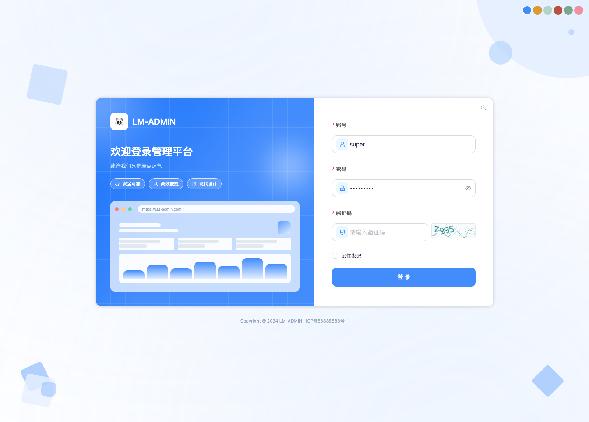
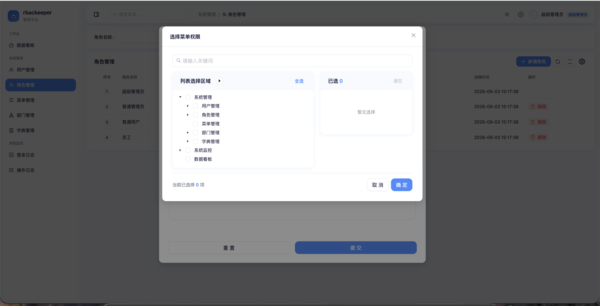
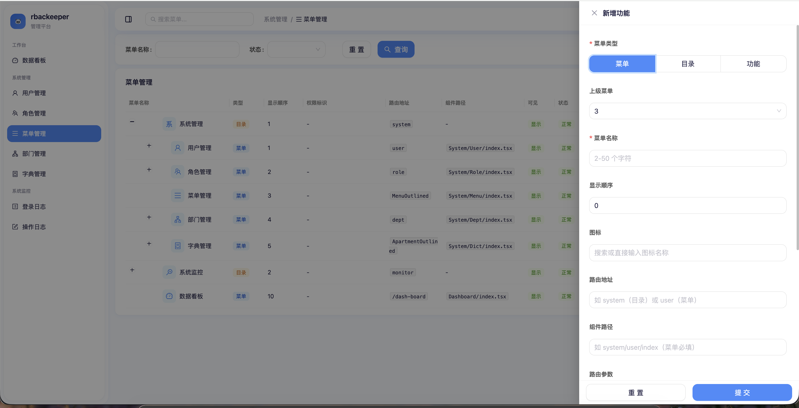
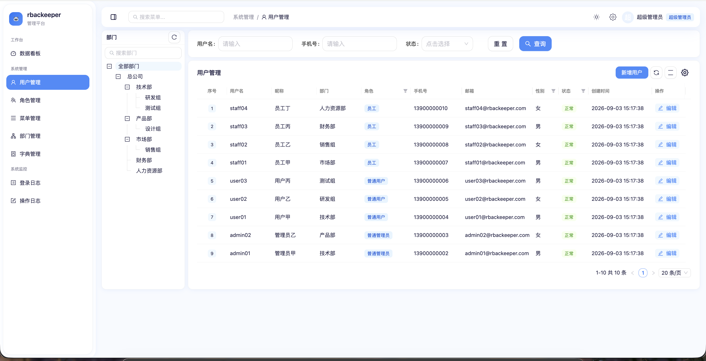
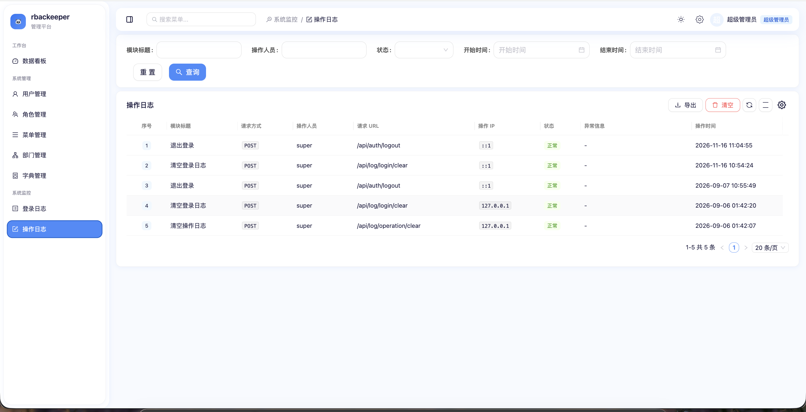

<a id="readme-top"></a>

<div align="center">

# RBAC Keeper System

**基于 RBAC 的后台权限管理系统**

<a href="#中文">中文</a>　|　<a href="#english">English</a>

</div>

<p align="center">
  <a href="./docs/images/admin-login.png">
    
  </a>
</p>
<p align="center"><sub>🖥️ 管理端登录页预览 · Admin login page preview</sub></p>

---

<a id="中文"></a>

## 🇨🇳 中文

<p align="right"><a href="#english">切换到 English →</a></p>

基于 RBAC 的后台权限管理系统，包含 React 管理端和 Go API 服务，提供用户、角色、菜单、部门、字典及登录/操作日志等功能。

### 🖼️ 界面预览

<table>
  <tr>
    <td align="center"><a href="./docs/images/admin-dashboard.png"></a><br><sub>📊 数据看板</sub></td>
    <td align="center"><a href="./docs/images/admin-users.png"></a><br><sub>👥 用户管理</sub></td>
  </tr>
  <tr>
    <td align="center"><a href="./docs/images/admin-roles.png"></a><br><sub>🛡️ 角色管理</sub></td>
    <td align="center"><a href="./docs/images/admin-departments.png"></a><br><sub>🏢 部门管理</sub></td>
  </tr>
  <tr>
    <td align="center"><a href="./docs/images/admin-operation-logs.png"></a><br><sub>📝 操作日志</sub></td>
    <td></td>
  </tr>
</table>

### 📁 项目结构

```text
.
├── admin/                  # React 管理端（Vite 项目）
│   ├── public/             # 静态资源
│   └── src/
│       ├── apis/           # 后端 API 封装
│       ├── components/     # 通用业务组件
│       ├── layout/         # 后台布局
│       ├── pages/          # 登录、看板、系统管理、日志等页面
│       ├── routers/        # 路由与鉴权
│       ├── stores/         # 全局状态
│       └── styles/         # 全局样式
└── server/                 # Go API 服务
    ├── config/             # 配置结构与读取
    ├── initialize/         # 数据库、缓存、消息队列、迁移和 seed 初始化
    ├── internal/           # auth、user、role、menu、dept、dict、log 等业务模块
    ├── middleware/         # JWT、RBAC、数据权限、限流、日志等中间件
    ├── model/              # GORM 数据模型
    ├── router/             # HTTP 路由注册与服务启动
    ├── utils/              # 通用工具及 Casbin 权限策略
    ├── config.yaml         # 后端运行配置
    ├── go.mod              # Go 模块及依赖
    └── main.go             # 后端启动入口
```

### 🧰 技术栈

**管理端 (`admin/`)**

- React 19、TypeScript 5、Vite 7
- Ant Design 6、Tailwind CSS 3、SCSS
- React Router 7、Zustand、TanStack Query、Axios
- ECharts、React ECharts

**服务端 (`server/`)**

- Go（模块声明版本为 Go 1.26.4）
- Gin：HTTP API；GORM：ORM 和数据库迁移
- MySQL：业务数据；Redis：缓存及限流
- RocketMQ：异步消息处理
- Casbin：RBAC 权限策略；JWT：身份认证
- Viper：YAML 配置；zerolog：日志
- MinIO 客户端已集成，但当前 `main.go` 中的 MinIO 初始化调用处于注释状态

### 🚀 启动管理端

需要安装 Node.js 和 pnpm：

```bash
cd admin
pnpm install
pnpm dev
```

Vite 默认在 `http://localhost:5173` 提供页面，开发服务器监听 `0.0.0.0`。开发环境中，前端的 `/api` 请求会代理到 `http://localhost:8001`。若修改后端监听端口，请同步修改 [admin/vite.config.ts](./admin/vite.config.ts) 中的代理目标。

其他常用命令：

```bash
pnpm build   # TypeScript 检查并构建生产文件
pnpm lint    # ESLint 检查
pnpm preview # 本地预览生产构建
```

### 🗄️ 初始化数据与启动服务端

#### 📋 启动前准备

服务端启动时会连接 `server/config.yaml` 中配置的 MySQL、Redis 和 RocketMQ；这些服务应预先运行并可从当前机器访问。请先创建配置中 DSN 指定的 MySQL 数据库，并按本机环境修改配置中的地址、账号和密码。项目没有在此仓库提供这些依赖的统一启动编排。

配置文件包含开发环境示例值。运行前请检查并替换所有连接凭据、JWT 密钥及服务地址；不要将真实密钥或生产凭据提交到版本库。当前启动流程需要 RocketMQ；MinIO 配置虽然存在，但启动代码暂未调用其初始化函数。

#### 🌱 数据库迁移和 seed 数据

运行 `go run .` 时，`server/main.go` 会先连接基础服务，再依次执行数据库迁移和内置数据初始化：

1. `initialize.RegisterMigrate()` 使用 GORM `AutoMigrate` 创建或同步用户、角色、菜单、部门、字典和日志等表。
2. `initialize.RegisterSeed()` 检查 `role_key = super` 是否已存在。若已存在则跳过；否则写入初始部门、菜单、角色、用户、字典类型和字典数据，并为用户密码生成哈希。
3. 后续初始化 Casbin 权限策略、日志消费者和 HTTP 服务。

`server/initialize/seed.go` 中的开发用初始账号为 `super`、`admin01`、`admin02`、`user01`–`user03` 和 `staff01`–`staff04`。这些内置账号共用源码中的初始密码 `123456aaa`。**仅供本地开发/演示使用；成功登录后应立即修改密码，不要用于生产环境。** Seed 是否执行以 `super` 角色是否存在为准，不会在每次启动时自动补齐其他 seed 记录。

#### ▶️ 启动命令

```bash
cd server
go run .
```

HTTP 服务监听 `config.yaml` 中 `server.port` 指定的端口（仓库示例为 `8001`）。前端开发代理默认也指向 `8001`。可以通过以下地址检查服务：

- 健康检查：`http://localhost:8001/healthz`
- 就绪检查：`http://localhost:8001/readyz`
- Swagger 文档：`http://localhost:8001/swagger/index.html`

### ⚙️ `server/config/config.go` 配置说明

`config.CFG` 定义服务使用的配置结构；`LoadConfig(path)` 通过 Viper 在指定目录查找 `config.yaml` 并反序列化配置。当前 `main.go` 传入 `"."`，因此从 `server/` 目录启动时读取 `server/config.yaml`。配置文件中的 YAML 键与结构体的 `mapstructure` 标签对应。

| 配置段 | 对应结构 | 用途 |
| --- | --- | --- |
| `mode` | `CFG.Mode` | 运行模式；影响 Gin 运行模式和日志/调试行为 |
| `log-max-age` | `CFG.LogMaxAge` | 旧日志保留天数；小于等于 0 时不清理 |
| `server` | `ServerConfig` | HTTP 监听端口、请求读取超时和响应写入超时 |
| `mysql` | `MySQLConfig` | MySQL DSN、连接池上限/空闲连接、连接最大存活时间及 GORM 日志级别 |
| `redis` | `RedisConfig` | Redis 地址、密码、数据库编号和连接池大小 |
| `minio` | `MinIOConfig` | MinIO 端点、访问凭据、存储桶、TLS 和预签名 URL 有效期 |
| `jwt` | `JWTConfig` | JWT 签名密钥、签发者，以及 Access/Refresh Token 有效期 |
| `ratelimit` | `RateLimitConfig` | 限流速率和令牌桶突发容量 |
| `rocketmq` | `RocketMQConfig` | NameServer/Broker 地址、ACL 凭据、消费者重试次数和发送超时 |

修改配置时应保持 YAML 键名与结构体标签一致。`time.Duration` 字段使用 Go 时长格式，例如 `30s`、`1h`；MySQL DSN 需要启用 `parseTime=true`。生产环境请使用强随机 JWT 密钥，并通过安全的配置注入方式提供凭据。

<p align="right"><a href="#readme-top">返回顶部 ↑</a></p>

---

<a id="english"></a>

## 🇬🇧 English

<p align="right"><a href="#中文">切换到中文 →</a></p>

An RBAC-based administration system with a React admin console and a Go API server. It includes user, role, menu, department, dictionary, login-log, and operation-log management.

### 🖼️ Screenshots

<table>
  <tr>
    <td align="center"><a href="./docs/images/admin-dashboard.png"></a><br><sub>📊 Dashboard</sub></td>
    <td align="center"><a href="./docs/images/admin-users.png"></a><br><sub>👥 User management</sub></td>
  </tr>
  <tr>
    <td align="center"><a href="./docs/images/admin-roles.png"></a><br><sub>🛡️ Role management</sub></td>
    <td align="center"><a href="./docs/images/admin-departments.png"></a><br><sub>🏢 Department management</sub></td>
  </tr>
  <tr>
    <td align="center"><a href="./docs/images/admin-operation-logs.png"></a><br><sub>📝 Operation logs</sub></td>
    <td></td>
  </tr>
</table>

### 📁 Project Structure

```text
.
├── admin/                  # React admin application (Vite)
│   ├── public/             # Static assets
│   └── src/
│       ├── apis/           # API client modules
│       ├── components/     # Shared UI components
│       ├── layout/         # Admin layout
│       ├── pages/          # Dashboard, login, system management, and logs
│       ├── routers/        # Routes and route guards
│       ├── stores/         # Global state
│       └── styles/         # Global styles
└── server/                 # Go API server
    ├── config/             # Configuration types and loading
    ├── initialize/         # Infrastructure, migrations, and seed data
    ├── internal/           # auth, user, role, menu, dept, dict, and log modules
    ├── middleware/         # JWT, RBAC, data scope, rate limiting, and logging
    ├── model/              # GORM data models
    ├── router/             # HTTP route registration and server startup
    ├── utils/              # Utilities and Casbin policy support
    ├── config.yaml         # Server configuration
    ├── go.mod              # Go module and dependencies
    └── main.go             # Server entry point
```

### 🧰 Tech Stack

**Admin (`admin/`)**

- React 19, TypeScript 5, and Vite 7
- Ant Design 6, Tailwind CSS 3, and SCSS
- React Router 7, Zustand, TanStack Query, and Axios
- ECharts and React ECharts

**Server (`server/`)**

- Go (the module declares Go 1.26.4)
- Gin for HTTP APIs; GORM for ORM and database migrations
- MySQL for application data; Redis for caching and rate limiting
- RocketMQ for asynchronous messaging
- Casbin for RBAC policies; JWT for authentication
- Viper for YAML configuration; zerolog for logging
- A MinIO client is integrated, but its initialization call is currently commented out in `main.go`

### 🚀 Start the Admin App

Install Node.js and pnpm, then run:

```bash
cd admin
pnpm install
pnpm dev
```

Vite serves the app at `http://localhost:5173` by default and listens on `0.0.0.0`. In development, requests under `/api` are proxied to `http://localhost:8001`. If you change the server port, update the proxy target in [admin/vite.config.ts](./admin/vite.config.ts).

Other useful commands:

```bash
pnpm build   # Type-check and create a production build
pnpm lint    # Run ESLint
pnpm preview # Preview the production build locally
```

### 🗄️ Seed Data and Start the Server

#### 📋 Prerequisites

At startup, the server connects to MySQL, Redis, and RocketMQ as configured in `server/config.yaml`. Make sure these services are running and reachable, create the MySQL database named in the configured DSN, and update the addresses and credentials for your environment. This repository does not include a unified orchestration setup for these dependencies.

The configuration file contains development example values. Review and replace all connection credentials, the JWT secret, and service addresses before running the application. Do not commit real secrets or production credentials. RocketMQ is required by the current startup flow. Although MinIO settings are present, MinIO initialization is not currently called at startup.

#### 🌱 Database Migration and Seed Data

When you run `go run .`, `server/main.go` connects to the infrastructure and then performs database migration and built-in data initialization:

1. `initialize.RegisterMigrate()` uses GORM `AutoMigrate` to create or update tables for users, roles, menus, departments, dictionaries, and logs.
2. `initialize.RegisterSeed()` checks whether a role with `role_key = super` exists. If it does, seeding is skipped; otherwise, initial departments, menus, roles, users, dictionary types, and dictionary data are inserted, and user passwords are hashed.
3. Casbin policies, log consumers, and the HTTP server are initialized afterward.

Development accounts defined in `server/initialize/seed.go` are `super`, `admin01`, `admin02`, `user01`–`user03`, and `staff01`–`staff04`. All built-in accounts share the initial password `123456aaa`, defined in the source. **This password is for local development and demos only. Change it immediately after signing in, and never use it in production.** Seeding is gated by the presence of the `super` role; it does not automatically restore other seed records on every startup.

#### ▶️ Start the Server

```bash
cd server
go run .
```

The HTTP server listens on the port configured by `server.port` in `config.yaml` (the repository example uses `8001`). The admin development proxy also targets port `8001` by default. Check the service at:

- Health check: `http://localhost:8001/healthz`
- Readiness check: `http://localhost:8001/readyz`
- Swagger UI: `http://localhost:8001/swagger/index.html`

### ⚙️ `server/config/config.go` Configuration

`config.CFG` defines the server configuration types. `LoadConfig(path)` uses Viper to find `config.yaml` in the specified directory and unmarshal it into the configuration struct. `main.go` currently passes `"."`, so running the server from `server/` loads `server/config.yaml`. YAML keys map to struct fields through their `mapstructure` tags.

| YAML section | Go structure | Purpose |
| --- | --- | --- |
| `mode` | `CFG.Mode` | Runtime mode; affects Gin mode and logging/debug behavior |
| `log-max-age` | `CFG.LogMaxAge` | Retention period for old logs; values less than or equal to 0 disable cleanup |
| `server` | `ServerConfig` | HTTP port, request read timeout, and response write timeout |
| `mysql` | `MySQLConfig` | MySQL DSN, connection pool limits, maximum connection lifetime, and GORM log level |
| `redis` | `RedisConfig` | Redis address, password, database number, and pool size |
| `minio` | `MinIOConfig` | MinIO endpoint, credentials, bucket, TLS, and presigned URL expiration |
| `jwt` | `JWTConfig` | JWT signing secret, issuer, and Access/Refresh Token expiration |
| `ratelimit` | `RateLimitConfig` | Token generation rate and burst capacity |
| `rocketmq` | `RocketMQConfig` | NameServer/Broker addresses, ACL credentials, consumer retry limit, and send timeout |

Keep YAML keys aligned with the struct tags. `time.Duration` values use Go duration syntax, such as `30s` or `1h`. The MySQL DSN must enable `parseTime=true`. For production, use a strong random JWT secret and provide credentials through a secure configuration mechanism.

<p align="right"><a href="#readme-top">Back to top ↑</a></p>
